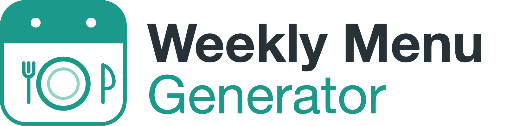

<p align="center"></p>

# Weekly Menu Generator (Veckomenygenerator)

En integration för Home Assistant som planerar familjens middagar för kommande vecka, tar hänsyn till allas allergier och kost, låter dig ändra enskilda middagar, och när du bekräftar lägger ingredienserna på dina inköpslistor (Home Assistants att göra-listor och/eller ICA-appen).

*English: [README.md](README.md)*  ·  Licens: [MIT](LICENSE)  ·  Tredjepartsnotiser: [NOTICE.md](NOTICE.md)

> **Status:** version 0.1.0, inte släppt än. Den har bara testats med automatiska tester, ännu inte i en riktig Home Assistant. Räkna med skavanker.

## Läs det här först

- **Allergier.** Integrationen filtrerar recept genom att läsa ingredienslistor, på svenska och engelska. Det är ett **filter efter bästa förmåga, ingen garanti**: det ser bara vad receptet listar, och det är medvetet försiktigt (det väljer hellre bort ett säkert recept än släpper igenom ett osäkert). **Kontrollera alltid innehållsförteckningar och recept själv**, särskilt vid svåra allergier. Lita inte på det här för medicinska beslut.
- **ICA är inofficiellt.** ICA har inget öppet API. Integrationen läser receptsidor på ica.se och använder ICA-appens gränssnitt för inköpslistan. ICA kan ändra eller blockera båda när som helst, och ICA:s egna villkor gäller för din användning av deras tjänster. Projektet har ingen koppling till ICA och är inte godkänt av ICA.
- **ICA svarar bara på anslutningar från Sverige**, så Home Assistant behöver en svensk IP-adress för ICA-inköpslistan.
- **Ditt personnummer och lösenord till ICA sparas i Home Assistants konfiguration** (som de flesta integrationer gör med inloggningar). Konton som bara använder BankID fungerar inte.

## Vad den gör

Varje fredagsmorgon (kan ändras) tar den fram ett utkast till meny för nästa vecka, för de veckodagar du valt, och meddelar dig. Du går igenom den på din dashboard: skapa om en middag (med ett valfritt önskemål), lås de du gillar, byt plats på två dagar eller välj ett av alternativen. När du bekräftar låses menyn och inköpslistorna byggs.

- **Recept** kommer från ICA-recept (populära middagsrecept från ica.se, på svenska) och, om du ställt in en, en **AI-uppgift** (AI Task) som Gemini, samt dina egna favoriter. AI:n får aldrig avgöra vad som är säkert: varje recept från varje källa går igenom samma kontroller. Se *Hur recepten väljs* nedan.
- **Familj:** varje person har allergier (hårda regler), kost (hård regel), ogillar och gillar (mjuka), portionsstorlek och vilka dagar hen äter middag. Bara de som äter en dag styr den dagen.
- **Ett recept, flera versioner.** Om det bara är en ingrediens som kan bytas som hindrar några används middagen ändå: biffreceptet blir kvar och vegetarianen får tofu; pastarätten blir kvar och den mjölkallergiska får havregrädde, lagat i rena, separata pannor. En middag kan ha upp till två extra versioner, och en inställning per person låter dig bestämma att någons allergi **aldrig** får hanteras så. Recept där buljong, ansjovis, ägg, soja eller nötter är i vägen delas inte upp.
- **Betyg och favoriter, per person.** Ge en middag 1 till 5 stjärnor och ett hjärta från menykortet eller kortet för kvällens middag (du agerar som personen som är kopplad till din Home Assistant-användare, eller väljer vem du betygsätter som, till exempel ett barn). Bara de som äter en dag räknas den dagen: ett barns betyg väger hälften av en vuxens, ett dåligt betyg väger mer än ett bra, och 1 stjärna från någon vid bordet håller receptet borta om inget annat passar. Favoriter och välbetygsatta recept erbjuds igen från ett lokalt lager, blandade med nya, men en favorit föreslås aldrig två veckor i rad (glappet går att ändra). Varje persons favoriter listas i familjekortet, där de kan tas bort. Allergier och kost kontrolleras alltid först.
- **Omväxling och matsvinn:** recept från de senaste sex veckorna undviks, vegetariska dagar och fiskdagar per vecka följs, och recept som delar ingredienser med resten av veckan rankas högre så att förpackningar tar slut.
- **Inköp:** mängder skalas efter vilka som äter varje dag, slås ihop mellan recept, avrundas uppåt till något du kan köpa och rensas från formuleringar som "gärna ICAs nötfärs 12% eller hushållsfärs". Skafferivaror (salt, olja...) hoppas över men listas. Varor som en butik inte kan placera hamnar på en granskningslista; inget försvinner utan att synas.
- **Notiser** (via Home Assistant-appen): menyn är klar med knapparna **Öppna / Bekräfta / Skapa om**, problem, bekräftad, och en påminnelse lördag klockan 12.
- **Dashboardkort:** meny, kvällens middag, inköpsresultat och familj, alla med visuella redigerare och på svenska eller engelska.

## Hur recepten väljs

Varje gång en meny eller en enskild middag tas fram samlar integrationen kandidatrecept och väljer sedan bland dem. Den frågar sina källor i den här ordningen:

1. **Dina favoriter och välbetygsatta recept** (när någon har betygsatt eller favoritmarkerat några). De sparas lokalt och utgör högst en tredjedel av kandidaterna, så att menyn blir en blandning av kända och nya middagar.
2. **Receptkälla: ICA-recept.** Populära middagsrecept från ica.se, som läses några sidor i taget och försiktigt, och sparas i ett lokalt lager så att samma sidor inte hämtas igen. Recept som inte kan användas (ett allergen bland ingredienserna, en kost som inte passar) hoppas över innan de kostar en förfrågan.
3. **AI-uppgift (AI Task), bara om du valt en AI Task-entitet i Home Assistant** (till exempel Gemini) och lämnat den på under *Receptkällor*. Den frågas bara när källorna ovan inte kunde fylla veckan, eller den enskilda dagen, med tillräckligt många användbara recept. Den får veta familjens allergier, kost, önskade stilar och eventuellt önskemål du skrivit, och måste svara med strukturerade recept: titel, ingredienser med mängder, tid, portioner och taggar. Utan en AI Task-entitet hoppas det här steget över och enbart ICA-recept används.

Om en källa misslyckas (sidan ligger nere, AI:n svarar nonsens) loggas det, menyn varnar för det och nästa källa provas.

**AI:n avgör aldrig vad som är säkert.** Varje kandidat från varje källa går igenom samma kontroller, i kod: allergier och kost hos de som äter den dagen är hårda regler, med möjlighet till en andra version av middagen för den som inte kan äta en ingrediens. Därefter rankas kandidaterna efter önskade stilar, gillar och ogillar, betyg och favoriter, hur nyligen receptet använts, vegetariska dagar och fiskdagar samt ingredienser som delas med resten av veckan, med lite slump så att inte samma middagar alltid vinner. Ett önskemål som "inte fisk" eller "gärna pasta" gäller alla källor, inte bara AI:n: det som utesluts filtreras bort och det som önskas rankas högre.

## Installera

Via HACS: lägg till det här arkivet som ett **eget arkiv** (kategori *Integration*), installera **Weekly Menu Generator** och starta om Home Assistant. Manuellt: kopiera `custom_components/weeklymenu` till mappen `custom_components` i din konfiguration och starta om.

Kräver Home Assistant 2025.8 eller nyare.

## Ställ in

1. *Inställningar → Enheter och tjänster → Lägg till integration → Weekly Menu Generator.* Välj språk (svenska eller engelska, oberoende av Home Assistants språk), enheter, att göra-listan eller listorna för inköp och, om du vill, en AI-uppgiftsentitet.
2. Öppna integrationen och välj **Konfigurera**:
   - **Schema:** dag och tid då menyn tas fram, och vilka veckodagar som behöver middag.
   - **Familjemedlemmar:** lägg till alla, med allergier, kost och vilka dagar de äter.
   - **Måltidsstilar:** önskade stilar, vegetariska dagar, fiskmiddagar och hur många middagar per vecka som får ha flera versioner.
   - **Receptkällor:** slå på eller av ICA-recept och AI-uppgift.
   - **Inköp:** att göra-listor, en lista för varor som behöver granskas och dina skafferivaror.
   - **Butikskonton:** din ICA-inloggning, för att använda en ICA-inköpslista (en ny lista varje vecka, eller en fast).
   - **Notiser:** `notify`-tjänster (till exempel `mobile_app_din_telefon`), vad du vill få notis om och vart *Öppna* leder.
3. Lägg korten på en dashboard (se nedan) och tryck på **Skapa meny** för att prova före fredag.

Om ICA slutar acceptera din inloggning ber Home Assistant dig logga in igen, och det som inte kunde levereras väntar tills du gjort det (`add_to_shopping` levererar det).

## Dashboardkort

Korten läggs till på dina dashboards automatiskt och finns i kortväljaren som **Weekly menu**, **Tonight's dinner**, **Shopping result** och **Family** (namnen följer webbläsarens språk). De hittar integrationens sensorer själva, så ingen entitet behöver anges.

```yaml
type: custom:weeklymenu-menu-card
title: Veckans middagar   # valfritt
show_images: true
show_actions: true        # false gör kortet skrivskyddat
```

Fler exempel, med vanliga kort och automationer, finns i [docs/dashboard-examples.md](docs/dashboard-examples.md) (på engelska). Syns inte ett kort: ladda om sidan utan cache; korten registreras när Home Assistant startar och kräver Home Assistants gränssnitt.

## Tjänster

| Tjänst | Vad den gör |
|---|---|
| `generate_menu` | Tar fram menyn för en vecka (standard: nästa vecka). Låsta dagar behålls. |
| `regenerate_day` | En ny middag för en dag, planerad runt resten av veckan. Valfritt önskemål. |
| `lock_day` | Lås eller lås upp en middag. |
| `swap_days` | Byt plats på två middagar i samma vecka. |
| `set_recipe` | Välj ett av dagens alternativ (låser också dagen). |
| `confirm_menu` | Lås menyn och bygg inköpslistorna. En bekräftad meny kan inte ändras. |
| `add_to_shopping` | Försök igen med det som inte kunde levereras (eller skicka allt igen). |
| `set_member`, `remove_member` | Ändra familjen. Gäller menyer som skapas från nu. |
| `rate_recipe` | Ge ett recept 1 till 5 stjärnor från en familjemedlem (0 tar tillbaka det). |
| `favorite_recipe` | Lägg till ett recept bland en medlems favoriter, eller ta bort det. |

Händelser: `weeklymenu_generation_due`, `weeklymenu_menu_ready`, `weeklymenu_confirmed` (med inköpsantal). Entiteter: sensorer för status, kvällens middag, varje veckodag, inköp och familj; en kalender med planerade middagar; knappar för att skapa och bekräfta.

## Integritet

Home Assistant pratar med: **ica.se** (receptsidor), **ICA:s appgränssnitt** (bara om du ställt in en ICA-lista, med din inloggning) och din **AI-uppgiftsleverantör**. AI:n får en förfrågan som nämner allergier, ogillar, kost och stilönskemål som vanliga ord, **inte** namnen på dina familjemedlemmar. Menyer, familjen och cachade recept sparas lokalt i Home Assistant.

## Kända begränsningar

- ICA-recepten är på svenska, och bara de ungefär tjugo mest populära recepten per rätttyp går att nå.
- Pluralformer slås inte ihop i inköp ("gul lök" och "gula lökar" blir två rader), och listorna sorteras inte efter butikens avdelningar.
- Önskemålet vid omskapande av en middag används bara av AI-uppgift.
- Mängderna vid uppdelade middagar är uppskattningar.

## Felsökning

- **Ingen meny skapades, eller dagar är tomma.** Öppna sensorn *Status*: dess attribut listar varningar, till exempel att ingen receptkälla är aktiv eller att inget recept passar alla en dag. Kontrollera *Konfigurera → Receptkällor* och att en AI-uppgiftsentitet är vald.
- **ICA säger att det är blockerat.** ICA svarar bara på anslutningar från Sverige.
- **Knapparna i notisen gör inget.** De kräver Home Assistant-appen och en `notify.mobile_app_…`-tjänst.

## Utveckling

Se [README.md](README.md#development).

## Licens

[MIT](LICENSE). ICA-inloggningen är portad från [LazyTarget/ha-ica-todo](https://github.com/LazyTarget/ha-ica-todo) via [kanylbullen/ica-mcp](https://github.com/kanylbullen/ica-mcp) (båda MIT; tack), och dashboardpaketet innehåller Lit (BSD-3-Clause). Deras notiser finns i [NOTICE.md](NOTICE.md).
